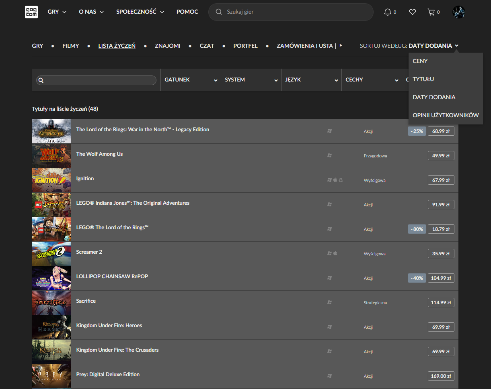

# GOG Wishlist - Sort by Price (Rozwijana lista/Przycisk)

Skrypty umożliwiające sortowanie gier według ceny (rosnąco lub malejąco) za pomocą natywnego rozwijanego menu lub przycisku na stronie listy życzeń serwisu GOG. Przełączanie się między sortowaniem według ceny a jedną z domyślnych opcji sortowania serwisu GOG (tytułu, daty dodania, opinii użytkowników) powoduje automatyczne, dwukrotnie odświeżenie strony.

## Zrzuty ekranu

")
")
Podgląd dodanej pozycji w natywnym menu rozwijanym.

")
")
Podgląd dodanego przycisku.

## Kompatybilność
Ten skrypt był testowany jedynie z [Tampermonkey](https://addons.mozilla.org/en-US/firefox/addon/tampermonkey/) i [Violentmonkey](https://addons.mozilla.org/en-US/firefox/addon/violentmonkey/) na [Firefoxie](https://www.mozilla.org/en-US/firefox/new/) oraz [Google Chrome](https://www.google.com/chrome/), choć pownien on także działać z innymi menadżerami skryptów oraz nowoczesnymi przeglądarkami.

## Instalacja
1. Zainstaluj menedżer skryptów dla swojej przeglądarki:
    * **Firefox**: [Greasemonkey](https://addons.mozilla.org/pl-PL/firefox/addon/greasemonkey/), [Tampermonkey](https://addons.mozilla.org/pl-PL/firefox/addon/tampermonkey/) lub [Violentmonkey](https://addons.mozilla.org/pl-PL/firefox/addon/violentmonkey/)
    * **Google Chrome** / **Vivaldi**: [Tampermonkey](https://chrome.google.com/webstore/detail/tampermonkey/dhdgffkkebhmkfjojejmpbldmpobfkfo) lub [Violentmonkey](https://chrome.google.com/webstore/detail/violentmonkey/jinjaccalgkegednnccohejagnlnfdag)
    * **Microsoft Edge**: [Tampermonkey](https://microsoftedge.microsoft.com/addons/detail/tampermonkey/iikmkjmpaadaobahmlepeloendndfphd) lub [Violentmonkey](https://microsoftedge.microsoft.com/addons/detail/violentmonkey/eeagobfjdenkkddmbclomhiblgggliao)
    * **Safari**: [Tampermonkey](https://apps.apple.com/app/tampermonkey/id6738342400)

2. Jeśli trzeba, zrestartuj przeglądarkę.

3. Zainstaluj preferowany skrypt:
    * [**Sort by Price (Natywne menu)**](https://raw.githubusercontent.com/Patrxgt/GOG-wishlist-sort-PL/main/gog-wishlist_sort-by-price_dropdown.user.js)
    * [**Sort by Price (Przycisk)**](https://github.com/Patrxgt/GOG-wishlist-sort-PL/raw/refs/heads/main/gog-wishlist_sort-by-price_button.user.js)
